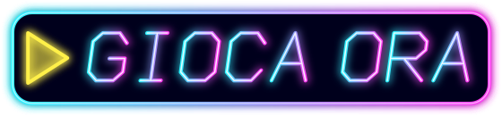
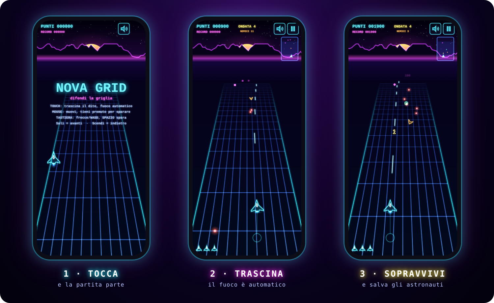

  

  

  
  
  
  

<b>Uno sparatutto arcade in stile anni '80, ispirato al classico <i>Juno First</i>. 
Griglia al neon, ondate di nemici dall'orizzonte e un solo obiettivo: sopravvivere.</b>

---

## 📱 Gioca subito sul telefono

<table>
<tr>
<td width="300" align="center">
  
</td>
<td>

**1. Inquadra il QR code** con la fotocamera del telefono 
oppure apri **[gtradigo.github.io/juno-clone](https://gtradigo.github.io/juno-clone/)**

**2. Tocca lo schermo** per iniziare: il suono parte insieme alla partita

**3. Tieni il dito sullo schermo e trascinalo**: l'astronave ti segue e spara da sola

> 💡 Gioca con il telefono in **verticale** e con il volume alzato.

</td>
</tr>
</table>

  

### ⭐ Mettila nella schermata Home

Così si apre a tutto schermo come una vera app:

| | |
|---|---|
| **iPhone** (Safari) | tocca **Condividi** <kbd>⬆</kbd> → **Aggiungi alla schermata Home** |
| **Android** (Chrome) | tocca il menu <kbd>⋮</kbd> → **Aggiungi a schermata Home** |

---

## 🎮 Comandi

| | Muoversi | Sparare |
|---|---|---|
| 👆 **Touch** | trascina il dito: la nave resta sempre **sopra** il dito, così la vedi | automatico finché tocchi |
| 🖱️ **Mouse** | muovi il puntatore | tieni premuto il tasto |
| ⌨️ **Tastiera** | frecce o <kbd>W</kbd><kbd>A</kbd><kbd>S</kbd><kbd>D</kbd> | <kbd>Spazio</kbd> |

**Porta la nave in alto per avanzare e in basso per arretrare.**
<kbd>P</kbd> mette in pausa, <kbd>M</kbd> toglie l'audio. Su telefono ci sono i pulsanti in alto a destra.

---

## 👾 Chi incontrerai

  

- **Drone**: ti insegue e spara ogni tanto.
- **Picchiatore**: aspetta, poi si lancia su di te in picchiata.
- **Tiratore**: resta a distanza e ti bersaglia.
- **Corazzato**: servono più colpi per abbatterlo, e spara a ventaglio.
- **Astronauta**: raccoglilo per avere punti bonus e qualche secondo di scudo.

Le ondate arrivano sempre **dall'orizzonte**, mai addosso a te. Ogni 10.000 punti guadagni una vita extra e il record resta salvato nel browser.

---

## 🧭 Consigli per sopravvivere

1. **Resta basso** quando arrivano troppi nemici: arretri e hai più tempo per mirare.
2. **Tieni d'occhio il radar** in alto a destra: mostra i nemici ancora oltre l'orizzonte.
3. **Salva gli astronauti**: ogni salvataggio vale più del precedente e ti protegge per un attimo.
4. **Non restare fermo**: i proiettili rossi puntano dove ti trovi.

---

## 💻 Su PC

Apri il [link del gioco](https://gtradigo.github.io/juno-clone/) oppure scarica [`index.html`](index.html) e aprilo con un doppio clic. Funziona con Chrome, Edge, Firefox e Safari, senza installare nulla.

Tutto il gioco (grafica, suoni ed effetti) sta in un unico file HTML, senza librerie esterne. 
Omaggio non ufficiale a <i>Juno First</i> (Konami, 1983).

